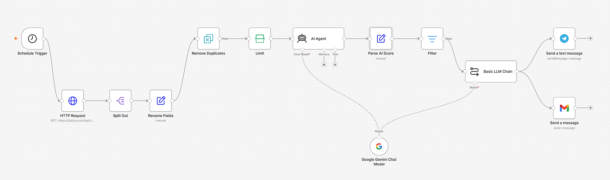

# AI Job Hunter (n8n)

An AI agent built with n8n that checks for new remote jobs every morning, scores each one against my skills using Gemini, drafts a tailored proposal for the good matches, and sends the result to Telegram and Gmail.

## What it does

1. **Schedule Trigger**: runs every day at 8:00 AM.
2. **HTTP Request + Split Out**: fetches the latest remote jobs from the Jobicy API and splits them into separate items.
3. **Rename Fields**: maps the API fields to `title`, `link` and `contentSnippet`.
4. **Remove Duplicates**: remembers job links from previous runs so the same job is never sent twice.
5. **Limit**: caps the number of jobs per run to stay within API rate limits.
6. **AI Agent (Gemini)**: scores each job from 1 to 10 against a skills profile and returns JSON with a score and a short reason.
7. **Parse AI Score**: turns the JSON reply into separate `score` and `reason` fields.
8. **Filter**: keeps only jobs with a score of 6 or higher.
9. **Basic LLM Chain**: writes a short proposal draft for each matching job.
10. **Telegram + Gmail**: delivers the job link, score and proposal draft.

## Tech stack

- n8n (Cloud)
- Google Gemini (`gemini-3.5-flash-lite`) via the Gemini API
- Jobicy public API
- Telegram Bot API and Gmail

## Setup

1. In n8n, create a new workflow and import `ai-job-hunter-workflow.json` (paste it onto the canvas or use Import from file).
2. Create these credentials in n8n:
   - Google Gemini (PaLM) API key
   - Telegram bot token (from @BotFather)
   - Gmail (Sign in with Google)
3. Replace the placeholders:
   - `YOUR_TELEGRAM_CHAT_ID` in the Telegram node
   - `YOUR_EMAIL@example.com` in the Gmail node
4. Edit the skills profile in the AI Agent's system message so it matches the person using it.
5. Run the workflow manually once to test, then publish it.

## Limitations

- The free Gemini tier has a per-minute request limit, so the number of jobs per run is capped.
- Proposal drafts are starting points. Review and edit them before sending.
- Job data comes from a single source (Jobicy), and scoring quality depends on the prompt.

## Credits

Job listings provided by [Jobicy](https://jobicy.com).
